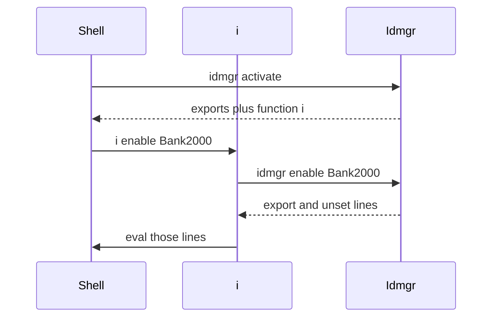

Two programs are involved. `idmgr` prints. `i` decides whether the current shell evals that printout.



`eval "$(idmgr activate)"` is how `i` gets into the shell. After that, `i enable Bank2000` is the load command. `idmgr enable Bank2000` prints the same lines and leaves them on the terminal.

## Dispatch

The script ends in `idm_core_cli`. Strict mode (`set -euo pipefail`) is set there. Libraries do not set it again.

The running parser reads three words:

```text
idmgr <menu> <action> [id] [extra...]
```

It calls `idm_<menu>__<action>`. An empty action is looked up as `_`. `--help` and `-h` select `core help`. `quit` and `q` select `core disable` and do not read an id word.

Lookup order:

1. `idm_<menu>__<action>`
2. `idm_<menu>_<action>`, with a warning `Debug mode enabled`
3. `idm_<menu>`
4. exit 1, `Command not matched`

`idmgr id` misses `idm_id__` and `idm_id_`, then calls `idm_id`, which lists ids. `idmgr ssh ls Bank2000` calls `idm_ssh__ls`. `idmgr bash status` calls `idm_bash__status`.

Core commands (`enable`, `disable`, `kill`, `activate`, `install`, `uninstall`) are functions `idm_core__*`. The help text and `i` use the short words. The live parser reaches those functions when the menu word is `core`. [Limits]() is the list of what that means for `i enable`.

Before the call, `<id>.env` and `<id>.secrets` are sourced when those files exist. A bad line aborts the process.

## What is stdout

The contract is: stdout is shell the parent can eval, stderr is logs.

Hook `export` and `unset` lines are stdout. `lib_log CODE` is stdout with no prefix. Every other log level goes to stderr. Nothing filters by verbosity, so the dispatch `DEBUG` line is always printed.

`i` evals stdout when the first word is in `IDM_SRC_WORDS` or is an existing id name. A bare id is on that allowlist. The parser that would treat a bare id as `enable` is commented out, so `i Bank2000` runs menu `Bank2000` and does not enable that id.

Single letters `e`, `d`, `k`, and `a` are allowlist words only. `q` is the `quit` path above.
