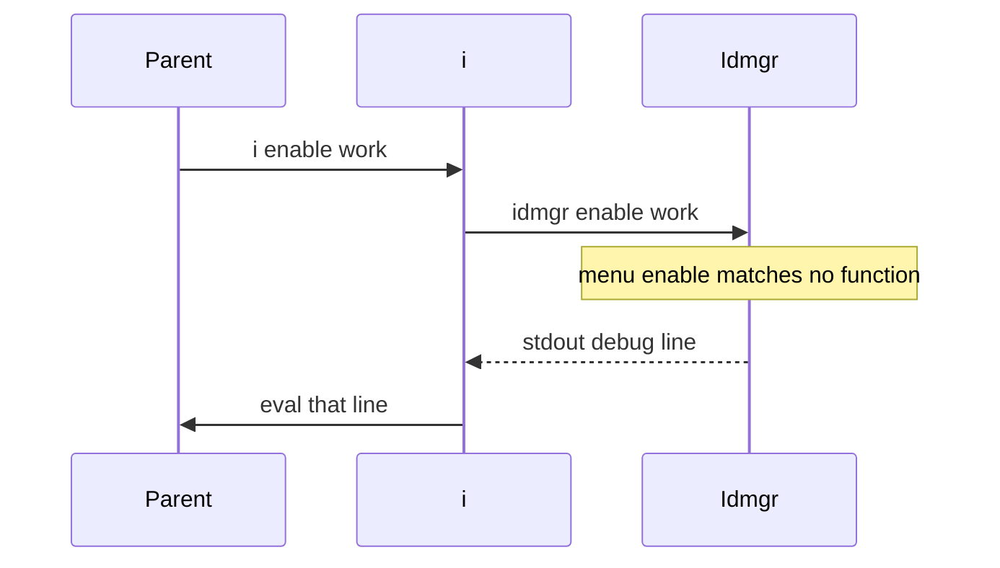
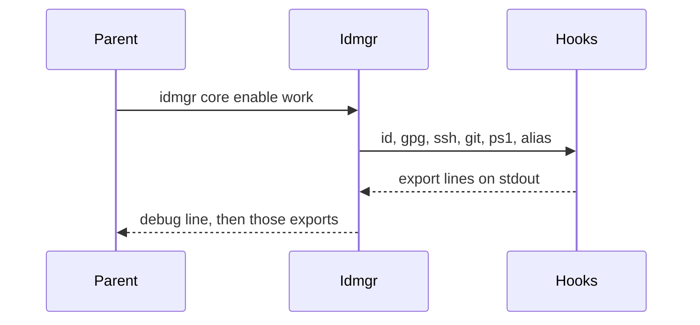

# Architecture

How the bash program produces the contract in [behavior.md](behavior.md). `idmgr` is a child process. It prints shell on stdout. The parent applies that shell only when something evals it.

Example id: `work`.

## Process

`bin/idmgr` ends by calling `idm_core_cli`. Strict mode (`set -euo pipefail`) is set there, not in the sourced libraries. `bin/idmgr.sh` is a symlink to `bin/idmgr`.

Startup records `IDM_CTX` as `executed` or `sourced` by comparing `$0` with `$_`. Dispatch does not read `IDM_CTX`. Sourcing `bin/idmgr` still runs `idm_core_cli`, because that call sits at the bottom of the file.

Enable and disable hooks must `echo` `export` and `unset`. They must not apply those variables in the child. `lib_log CODE` writes the message to stdout with no prefix. Every other level goes to stderr.



The path that runs hooks is `core enable`, and `i` does not eval a first word of `core`:



## Paths

Set at startup, keeping a value that is already in the environment:

| Variable | Default |
| --- | --- |
| `IDM_BIN` | `$0` |
| `IDM_DIR_ROOT` | realpath of the parent of the script |
| `IDM_ID_ENV_DIR`, `IDM_CONFIG_DIR` | `${XDG_CONFIG_HOME:-~/.config}/idmgr` |
| `IDM_DIR_ID` | `$IDM_ID_ENV_DIR/id` |
| `IDM_DIR_LIB` | `$IDM_DIR_ROOT/lib` |
| `IDM_DIR_CACHE` | `${XDG_CACHE_HOME:-~/.cache}/idmgr` |
| `XDG_RUNTIME_DIR` | `$HOME/.local/run` |

Startup creates the runtime dir, the config dir, the id dir, and the cache dir.

`IDM_SRC_WORDS` is `enable disable kill activate quit e d k a q`.

## Boot and order

`idm_core_init` sets `EDITOR` to `vim` when unset, empties `IDM_LIB_TABLE`, and sets the column format to `mod enable disable status`. It then calls `idm_lib_order_set` with enable, disable, and status priorities:

| Module | enable | disable | status |
| --- | --- | --- | --- |
| id | 10 | 90 | 10 |
| gpg | 11 | 89 | 11 |
| ssh | 12 | 88 | 12 |
| git | 50 | 50 | 50 |
| ps1 | 60 | 40 | 60 |
| alias | 60 | 40 | 60 |

`idm_lib_order_get` sorts the table lexically on the column for that chain. Enable and status run `id`, `gpg`, `ssh`, `git`, then `ps1` and `alias` (both 60 on enable, both 40 on disable). Disable runs the low priorities first: `ps1` and `alias`, then `git`, `ssh`, `gpg`, `id`. `sort` has no tie break, so `ps1` and `alias` can swap. `idm_lib_order_set` refuses a second row for a name that is already present.

`idm_lib_load lib` sources every `lib/idmgr_lib_*.sh`. `idm_lib_load mod` sources every `lib/idmgr_mod_*.sh`. Source order is directory order, not the table. After a mod loads, a set `IDM_MOD_<NAME>_PRIO` would add a row. No module sets that variable.

Commented `IDM_MOD_*_DEPS` lines and `idm_mod_order` (the tsort walker) are unused by enable. `idm_core_mods` calls that walker. The enable path does not call `idm_core_mods`.

`pass`, `gh`, `gitea`, `cloud`, and `tomb` are sourced. They have no table row, so the chains skip them. Direct dispatch still finds their functions.

A trap on `INT`, `TERM`, and `EXIT` calls `idm_exit_trap`.

## Dispatch

`idm_core_cli` maps `--help` and `-h` to `core help`, and `quit` and `q` to `core disable`. `quit` and `q` do not copy the next word into the id. Every other argv is `menu=$1`, `action=$2`, `id=$3`, and the remainder is `opt`.

Before the call, `<id>.env` and `<id>.secrets` are sourced when those files exist. A bad line aborts the process in the trap.

Lookup order:

1. `idm_<menu>__<action>` 
2. `idm_<menu>_<action>`, with a warning `Debug mode enabled`
3. `idm_<menu>`
4. `idm_exit 1` with `Command not matched`

An empty action is looked up as `_`. `idmgr id` therefore misses `idm_id__` and `idm_id_`, then calls `idm_id`, which lists ids.

`core enable` is the function `idm_core__enable`. `enable work` looks for `idm_enable__work`. The allowlist in `i` and the help text use the short words. The functions live under menu `core`, or under the module name (`ssh`, `gpg`, `id`, ...).

The first executable line of dispatch is:

```bash
echo YOOOO menu=$menu , action=$action , id=$id , opt=$opt
```

That line is stdout, ahead of any hook output.

## Hook engine

`idm_core_exec_mod` takes the id, the hook suffix (`__enable`, `__disable`, `__ls`, `__help`), a `printf` pattern, and the module names. For each name:

- Skip when `IDM_DISABLE_AUTO`, with spaces turned into colons, contains `:<mod><suffix>:`. The token for git enable is `git__enable`.
- Skip, with an `INFO` line, when `idm_<mod><suffix>` is not a function.
- Otherwise capture stdout with `out="$( idm_<mod><suffix> "$id" || rc=$? )"`.

`rc` is assigned inside the command substitution, so the parent `rc` stays 0. The branch that logs `Module <mod> failed` does not run. A hook that returns non-zero and prints nothing leaves no `NOTICE`. A hook that prints and returns 0 is announced with `NOTICE` of the pattern (`Enabling git ...`) and then the captured text is printed. The pattern `_` suppresses that `NOTICE`. Empty stdout suppresses it too, which is why alias enable is silent.

stderr from the hook (warnings, agent logs) is not captured. It appears while the hook runs.

## Enable, disable, kill

`idm_core__enable` requires `lib_id_has_config`. The id argument defaults to `SHELL_ID`.

- Same id as `SHELL_ID`: warn `Your workspace is already activated`, then run the hooks.
- A different non-empty `SHELL_ID`: warn `Changing <old> workspace to <id>`, then run `$IDM_BIN disable <old>`. The child argv is menu `disable`, action `<old>`. That does not select `idm_core__disable`. The child exits 1. `set -e` stops enable before the hooks. The child's stdout is not eval'd by `i`.
- Empty `SHELL_ID`: run the enable chain.

The chain is `idm_lib_order_get enable`. After it, a `NOTICE` says the identity is loaded. The id hook writes `~/.cache/idmgr/last_id` when `IDM_LAST_ID_SAVE` is `true` or unset.

`idm_core__disable` calls `lib_id_is_enabled`, then the disable chain with pattern `Disabling %s ...`, then a `NOTICE` that the id is unloaded. The id hook writes `_` into `last_id`.

`lib_id_is_enabled` fails when the argument is `_`, and when the argument is not equal to `SHELL_ID`. The warning text repeats the argument in both places. It does not print the value of `SHELL_ID`.

`idm_core__kill` uses the same disable chain and the same functions (`__disable`, not `__kill`). The pattern is `Killing %s ...`. The final notice says the id was killed. Module `__kill` runs only when that menu is dispatched (`ssh kill work`, `gpg kill work`). `id`, `git`, `ps1`, `gh`, `gitea`, and `cloud` define `__kill` as disable. `alias` `__kill` is empty. `tomb` `__kill` returns 0.

## Shell payload

`idm_core__activate` takes an optional shell name. The default expansion is `${1-:${SHELL##*/}}`, so the notice shows `Activate shell: :bash`. The body does not branch on that name. It always prints bash.

It calls `idm_bash__status`. The status is `activated` when `IDM_SHELL_PS1` is set, and `installed` when `lib_snippet_has` finds the bash marker in `~/.bashrc`. An `uninstalled` status logs `bash is not configured`.

Stdout is:

```bash
export IDM_BIN=<path>
export IDM_DIR_ROOT='<root>'
IDM_SRC_WORDS='enable disable kill activate quit e d k a q'
IDM_DIR_ID='<id dir>'
```

then `tail -n +2` of `shell/bash.sh` (the shebang is dropped). `shell/bash/startup.sh` is not part of this payload.

`i` in that file builds an allowlist from `IDM_SRC_WORDS`, from `idmgr id names`, and from `*.env` filenames. A matching first word runs `idmgr`, then `eval`s stdout. Any other first word runs `idmgr` with stdout inherited. `IDM_DEBUG=true` on the eval path prints a debug banner on stderr and prints the captured stdout before eval.

`i_restore_last_id` returns immediately unless `IDM_LAST_ID_AUTOLOAD` is `true`. If `SHELL_ID` is set it calls `i enable <SHELL_ID>`. Otherwise it reads `$IDM_DIR_CACHE/last_id` and, when the name is not empty after underscores are removed, calls `i enable <name>`.

The payload ends with `bind -x '"\C-b": i disable'` and a call to `i_restore_last_id`.

## Snippets

`lib/idmgr_lib_snippet.sh` wraps a body in marker lines. The default comment is `#`, the default markers are `BEGIN idmgr:%s` and `END idmgr:%s`.

`idm_core_hook_each` handles `install` and `uninstall`. The target is `all` (bash, then every ordered module that defines the hook), `bash`, or one module name. A missing hook exits 1. Today the only module hook is ssh. `core install work all` therefore installs bash and ssh. The id word is required by the parser. The bash hook ignores it.

Bash appends, at the end of `~/.bashrc`:

```bash
eval "$( <IDM_BIN> activate )"
```

The word inside the eval is `activate`, not `core activate`.

SSH creates `~/.ssh` and `~/.ssh/config.d` at mode `700` when missing, and inserts this at the beginning of `~/.ssh/config`:

```text
Include ~/.ssh/config.d/*
```

`core comp` cats `comp/pass.sh`, `comp/yadm.sh`, `comp/ssh.sh`, `comp/gpg.sh`, and `comp/idmgr.sh` under `IDM_DIR_ROOT`. The `comp/` directory is not in the tree. `set -e` stops on the first missing file.

## Modules

Each file is `lib/idmgr_mod_<name>.sh`. A user command is `idm_<name>__<action>`. A helper is `idm_<name>_<helper>`. The first argument of a hook is the id.

### id

`idm_id__enable` prints `SHELL_ID` and the four git author and committer variables, then saves `last_id`. `common_name` defaults to the id. `idm_id__disable` prints the matching `unset` and saves `_`.

`idm_id__new` checks the name, refuses an existing file, writes the template, and runs `$EDITOR`. The template's `comment=` value is unquoted, so a sourced file fails until that line is quoted or removed. `idm_id__ls` prints `*`, or a blank, the id, and `common_name (email)` through `column`. `idm_id__show` checks the file and does not print it. `idm_id__dump` iterates `idm_get all_id`, which is not defined.

### ssh

Socket directory: `$XDG_RUNTIME_DIR/ssh-agent/<id>/`. Socket file: `socket`. Agent lifetime passed to `ssh-agent` is `4w`. `idm_ssh__agent_start` writes the agent's `SSH_*` lines to `env` in that directory and sources them in the child.

`idm_ssh__enable` unsets `SSH_AUTH_SOCK` and `SSH_AGENT_PID` in the child, exports the socket path, and starts the agent when `ssh-add -l` against that socket fails. `IDM_NO_BG=true` or a set `DIRENV_IN_ENVRC` skips the start and logs a `TIPS` line (`TIPS` matches the `TIP` level check). The line tells the user to run `idmgr <id>`. Stdout is `export SSH_AUTH_SOCK=...`.

`idm_ssh__disable` prints the two `unset`s. `idm_ssh__kill` sources `env` when `SSH_AGENT_PID` is empty, runs `ssh-agent -k` when the pid is alive, deletes `env`, and prints the unset.

`idm_ssh__new` is interactive: username, hostname, letters `n` (ed25519), `s` (rsa 4096), `o` (rsa 2048), passphrase twice. Key files are `<dest>/<user>_<type>_<YYYYMMDD>`. Default dest for a known id is `~/.ssh/<id>`.

`idm_ssh__add` asks `lib_id_is_enabled`, finds private keys next to `*.pub` under `~/.ssh/<id>` (a sibling `.key` or the path with `.pub` removed), and runs `ssh-add`.

`idm_ssh__status` is `activated` when `SSH_AUTH_SOCK` is set, and `installed` when the ssh snippet is in `~/.ssh/config`.

### gpg

`idm_gpg_header` sets `GNUPGHOME` to `~/.config/gpg/<id>` and `GPG_TTY` from `tty`. Runtime dir: `$XDG_RUNTIME_DIR/pgp-agent/<id>/`. `idm_gpg_start` creates both directories at mode `700`, writes `env` (`GNUPGHOME`, `GPG_AGENT_INFO` pointing at `socket`, `GPG_DEFAULT_ID`), and runs `gpg-agent --daemon`.

`idm_gpg__enable` sources `env` when it exists, starts the agent when the socket is missing and background start is allowed, cats `env`, and prints `GPG_TTY` and `GNUPGHOME`. Disable unsets `GPG_AGENT_INFO`, `GNUPGHOME`, and `GPG_TTY`. Kill runs `gpgconf --kill gpg-agent` and then disable.

`idm_gpg__init` refuses an existing key, fills `shell/gpg_gen.tpl` from the id file (RSA 4096, expire `2y`), and runs `gpg2 --batch --gen-key`. `idm_gpg__new` adds a subkey. Export writes `~/.config/idmgr/gpg/<id>_pub.asc` and `<id>_priv.asc`.

### git

`idm_vars_git_id` sets `git_dir` to `$IDM_DIR_CACHE/git/<id>/local.git` and `git_work_tree` to `$HOME`. The include file is `$IDM_CONFIG_DIR/git/<id>/local_gitconfig`. Permissions live beside it in `local_perms`.

`idm_git__enable` prints `GIT_DIR` and `GIT_WORK_TREE`. Disable unsets them. `idm_git` forwards any other action to `lib_git` in that repo, after `lib_id_is_enabled`. `idm_git__repo` dispatches `idm_git__repo_<sub>` so remotes are git config keys `idmgr-sources.<name>` in the include file.

### ps1

On load, the payload saves the current `PS1` as `IDM_SHELL_PS1`. `idm_ps1__enable_raw` prints `PS1` as a blue `(id)` plus that saved value. When `PS1_PREFIX` is already set, `idm_ps1__enable_suffix` prints `PS1_PREFIX` instead. Disable unsets `PS1_PREFIX` or restores `PS1` from `IDM_SHELL_PS1`.

### pass

`idm_pass__enable` prints `export PASSWORD_STORE_DIR=~/.config/pass/<id>` and creates that directory. The leading `! lib_id_has_config` does not stop the function: `set -e` ignores a failed `!` command. `idm_pass` forwards other verbs to `pass` after `lib_id_is_enabled` and `lib_require_bin pass`.

### gh, gitea, cloud, tomb

`gh` enable prints `GH_TOKEN` and `GH_REPO` from `gh_token` and `gh_repo` in the sourced id file. Disable unsets them.

`gitea` enable returns immediately unless `gitea_url`, `gitea_login`, and `gitea_token` are set. It adds a `tea` login when the name is missing, then prints `GITEA_LOGIN` and `GITEA_SERVER_URL`. `GITEA_SERVER_URL` is set from `gitea_token`.

`cloud` enable exports `OS_CLOUD=~/.config/openstack/<id>_clouds.yaml` only when that path exists as a file. The test quotes the tilde, so the looked-up path is the literal string starting with `~`, and the export usually does not run. Disable unsets `OS_CLOUD`.

`tomb` enable, disable, and kill return 0. The encrypted file is `$IDM_CONFIG_DIR/enc/<id>.tomb`. The tomb git dir is `$IDM_DIR_CACHE/git/<id>/tomb.git`. `init`, `decrypt`, `sync`, `encrypt`, `push`, `shred`, and `rm` operate on that pair. Help names `import` and `leave`. Those functions are not defined.

### alias

Enable and disable only check that the id file exists. They print nothing. `virsh` and `virt_manager` take a host, pick the first private key from the ssh search, and `exec` the qemu+ssh URL as root. `sshuttle` lists routes, then `exec`s `sshuttle`.

## Logging and exit

`lib_log` accepts `ERR`, `WARN`, `TIP`, `NOTICE`, `INFO`, `DEBUG`, `RUN`, `CODE`, `DUMP`, `DEPRECATED`, `ASK`. The check is a regex, so `TIPS` is accepted. The label is formatted to 6 characters. `CODE` is stdout. `DUMP` is cyan and indented on stderr. Other levels are colored prefixes on stderr. Nothing filters by verbosity, so the dispatch `DEBUG` line is always printed.

`idm_exit` takes `rc`, or `rc` and a message (logged at `DEBUG`), or `rc`, a level, and a message. A non-zero `rc` logs and exits. The trap is cleared before `exit`, so a normal `idm_exit` does not also dump a stack.

`idm_exit_trap` runs on the `EXIT` trap. A non-zero status logs `ERR` and `lib_trace` (`caller` 0 through 10).

`idm_core__help` prints the static core text, lists the status order, then runs `set -x`. The following `idm_core_exec_mod $id __help` reads `$id` from that function. `id` is local to `idm_core_cli`, so the empty word is dropped and the arguments shift: the id becomes `__help`, the action becomes `%s`, and the first module name is consumed as the pattern. The engine then looks up `idm_<mod>%s`, skips every module, and leaves xtrace on.

## As it runs today

These are the mismatches that change the contract above:

- Dispatch prints the `YOOOO` line on stdout before the command.
- `core help` shifts `idm_core_exec_mod` onto `__help` and `%s`, skips every module help hook, and leaves `set -x` on.
- `core kill` calls `__disable`, not `__kill`.
- Switching ids runs a child `disable <old>` that does not select `core disable`, and enable then aborts.
- `pass`, `gh`, `gitea`, `cloud`, and `tomb` are absent from the order table.
- `e`, `d`, `k`, and `a` are allowlist words only. `q` selects `core disable` and drops the id.
- Help text and the bashrc snippet use `enable`, `activate`, and `install` without the `core` menu.
- Hook failure status does not reach the engine, because `rc` is set in the capture subshell.
